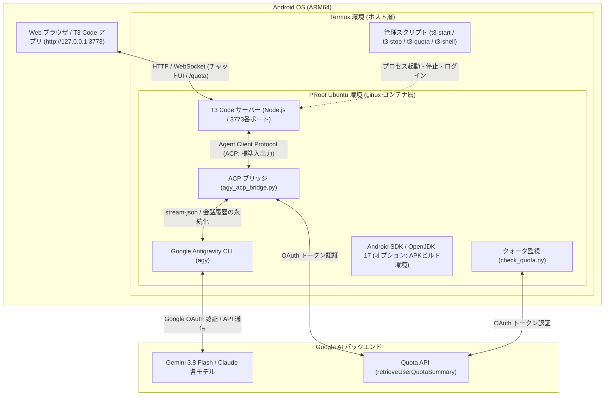

# Antigravity & T3 Code on Android (Termux)

<p align="center">
  
</p>

Android 上の **Termux**（Google Play 版 / GitHub Releases 版 / F-Droid 版）および **proot-distro (Ubuntu)** を利用し、[T3 Code](https://github.com/pingdotgg/t3code) と **Google Antigravity CLI (`agy`)** を連携させて、Android 端末単体で完全な自律型 AI コーディング環境をワンライナーで構築するためのスクリプト群です。

オプションで、ARM64 環境に最適化された **Android SDK (APK/AAB ビルド環境)** の自動構築もサポートします。

---

## 🎯 本リポジトリの目的

本リポジトリは、**T3 Code が標準で提供する Antigravity の仕組みを使用するのではなく、端末上で自前でセットアップした Antigravity CLI (`agy`) を T3 Code で使えるようにする** ことを目的に作成されています。

- **T3 Code 標準の仕組みとの違い**:
  T3 Code が標準で想定している Antigravity プロバイダは公式の ACP サーバーバイナリ（約 2GB）をダウンロードして動作させようとしますが、Android（ARM64）特有の仮想アドレス空間（39-bit VA）制約により、PRoot Ubuntu 環境では起動時にクラッシュ（`Aborted`）してしまいます。
- **本リポジトリのアプローチ**:
  環境内に自前でインストールし、Google アカウント認証を済ませた公式 Antigravity CLI (`agy`) をそのまま利用します。T3 Code と自前 CLI の間に軽量な Python 製 ACP ブリッジ（`scripts/agy_acp_bridge.py`）を配置することで、T3 Code のチャット UI から自前 Antigravity CLI を安定してフル活用できるようにしています。

---

## 主な特徴

- 🚀 **ワンライナー導入**: Termux 上で 1 行のコマンドを実行するだけで Ubuntu 環境、Node.js、T3 Code、Antigravity CLI まで完全自動構築。
- 🤖 **公式 Antigravity CLI (`agy`) ネイティブ連携**:
  - Google 公式の Antigravity CLI (`linux_arm64`) を利用。Termux / PRoot Ubuntu 環境から **Google アカウント認証 (OAuth)** で本物の AI と直接対話可能。
  - API キーの発行や従量課金設定は不要。
- 🧠 **最新モデル & 契約プラン動的同期**:
  - `agy models` によりログイン中アカウントの契約プランで利用可能なモデル（Gemini 3.8 Flash, Claude Sonnet 4.6, Claude Opus 4.6, GPT-OSS 等）を自動取得して T3 Code 画面に完全同期。
  - アカウント別の思考レベル（High / Medium / Low）の選択にもネイティブ対応。
- ⚡ **自律エージェント機能（全ツール自動承認）**:
  - エージェント実行時に `--dangerously-skip-permissions` を自動適用。
  - ファイルの作成・編集、ディレクトリ探索、シェルコマンドの実行などを AI が自律的に完結。
  - 高速コードベース検索ツール **ripgrep (`rg`)** も自動セットアップされ、AI エージェントによる大規模プロジェクトのコード探索やシンボル検索が高速・快適に動作。
- 💬 **マルチターン会話の完全永続化**:
  - T3 Code のスレッドごとのセッション ID と Antigravity CLI の会話履歴 (`--conversation`) を自動的にマッピング・永続化 (`~/.gemini/antigravity-acp/session_map.json`)。
  - スレッド内で会話が複数ターンに及んでも以前の文脈や指示を完全に保持。
- 🛡 **Android ARM64 最適化ブリッジ & リアルタイムストリーミング**:
  - Android 特有の仮想アドレス空間（39-bit VA）起因で公式 ACP サーバーバイナリが異常終了（Aborted）する問題を解消する軽量 ACP ブリッジ (`scripts/agy_acp_bridge.py`) を提供。
  - `stream-json` 連携により、応答テキストの逐次ストリーミングに加えてツール実行状況（Bash コマンド実行等）をリアルタイム可視化。
  - **非同期キャンセル・ステアリング対応**: 生成処理中のチャット再入力や中断（`session/cancel` RPC）を非同期検知し、プロセスグループ（`SIGTERM`）を安全かつミリ秒単位で即座停止。タイムアウトエラー（`call-rpc failed for method session/cancel`）を完全に防止。
  - Gemini 3 系モデルでの `--effort medium` 自動付与や、モデル・セッションエラー時の自動フォールバック機構を内蔵。
- 📊 **利用状況 (Quota / レート制限) のリアルタイム把握**:
  - **T3 Code チャット画面**: `/quota` や `/usage` に加え、**「使用量」「使用状況」「/使用量」「残量」などの日本語**で送信するだけでも、**推論トークンを消費することなく**（0 トークンで）即座に最新の残りパーセント（Gemini / Claude 各グループの 5時間枠・週間枠、全回復予定時刻）をグラフィカルに表示。※ OpenAI Codex 導入時は Codex のレート制限・残り枠も自動で併記されます。
  - **モデル選択メニュー**: ドロップダウンのモデル名横に現在の残り枠（例: `Gemini 3.8 Flash (High) [残72%]`, `GPT-6-Luna [残99%]`）を動的表示。切り替え前に残量を一目で確認可能。
  - **ターミナル連携**: Termux / Ubuntu 上で `t3-quota`（または日本語コマンド `使用量` / `使用状況`）を実行するだけでも即座に確認可能（Codex がインストールされていれば OpenAI Codex の利用状況も自動検出して一括表示）。
- 🎯 **スラッシュコマンド補完 & トークン消費ゼロのヘルプガイド**:
  - **チャット欄での `/` 入力サジェスト**: 入力欄で `/` を入力するだけで、利用可能なコマンド群（`/boost`, `/plan`, `/goal`, `/teamwork-preview`, `/grill-me`, `/quota`, `/help` 等）が日本語の説明付きでポップアップ表示。
  - **トークン消費ゼロの即答ヘルプ**: `/help`、`/ヘルプ`、または「ヘルプ」「コマンド一覧」と送信するだけで、**推論トークンを消費することなく**（0 秒即答）利用可能な全コマンド・機能ガイドをグラフィカルに表示。
- 🛠 **Android SDK ビルド環境（オプション）**:
  - ARM64 版 `aapt2` のパッチ適用済み。端末内での Gradle による APK ビルドが可能。
- 🤖 **OpenAI Codex CLI 連携（オプション）**:
  - 公式 Codex CLI (`@openai/codex`) の ARM64 静的バイナリと T3 Code の `codex app-server` 連携をワンタッチ構築。
  - ChatGPT アカウントの OAuth デバイス認証 (`codex login`) または OpenAI API キーに対応。
  - 軽量プロキシブリッジ (`scripts/codex_t3_bridge.py`) により、T3 Code のモデル選択画面で Codex モデル（GPT-6-Luna 等）の横にもリアルタイム残量（`[残99%]` 等）を自動付加。
- 🐙 **GitHub CLI (`gh`) 連携（オプション）**:
  - 公式最新 APT リポジトリから ARM64 向け `gh` を導入。OAuth デバイス認証（`gh auth login`）で Git 認証ヘルパーや Pull Request・Issue 操作を自動完結。
- 🔮 **Claude Code CLI (Google Cloud Vertex AI 連携・オプション)**:
  - Anthropic 公式の **Claude Code CLI (`@anthropic-ai/claude-code`)** を Google Cloud Vertex AI (Agent Platform) 経由で完全セットアップ。
  - セットアップ時に **GCP プロジェクトID** と **リージョン** を対話的に入力・自動構成。
  - `gcloud` の Application Default Credentials (ADC) や `~/.claude/settings.json` の自動連携により、企業の GCP 課金・IAM 権限管理のもとで Claude 3.7 / 3.5 モデルを活用可能。
- 🔔 **Android ネイティブ通知連携 (Termux:API)**:
  - **Antigravity & Codex 両対応**: AI のタスク・思考処理が完了したタイミングで、Android システムの通知（ヘッドアップ通知・サウンド付き）を自動発行。
  - **画面 OFF・バックグラウンド完全対応**: ブラウザを閉じたり別アプリを操作していても、Termux の常駐サービス経由で処理完了を確実に察知。
  - **スマートな通知管理**: 通知トレイが溢れないよう、直前の通知を自動で上書き管理（ID固定）。
  - ※ 通知をオフにしたい場合は環境変数 `TERMUX_NOTIFICATION=0` を指定して起動できます。
- 📱 **直感的な操作コマンド**:
  - `t3-start`、`t3-stop`、`t3-status`、`t3-quota`、`t3-shell`、`codex`、`gh`、`claude`、`t3-install-codex`、`t3-install-gh`、`t3-install-claude` などの Termux コマンドを自動生成。

---

## 前提条件

1. **Android 端末** (ARM64 / aarch64):
   - **実機検証済み端末**: **Google Pixel 10 Pro Fold**
   - **対象となる ARM64 (aarch64) 端末の例**:
     - **Google Pixel**: Pixel 6 以降（Pixel 7, 8, 9, 10 シリーズ、Pixel Fold / Pixel 9 Pro Fold / Pixel 10 Pro Fold、Pixel Tablet 等）
     - **Samsung Galaxy**: Galaxy S21〜S25 シリーズ、Galaxy Z Fold / Flip シリーズ、Galaxy Tab S シリーズ等
     - **Sony Xperia**: Xperia 1 / 5 / 10 各世代等
     - **その他**: Snapdragon / Dimensity / Tensor 搭載の各社スマートフォン・タブレット全般（Xiaomi, OPPO, vivo, OnePlus, ASUS ROG Phone, Motorola 等）
     - ※ 近年発売された Android 端末の大部分（ほぼ 100%）は ARM64 (aarch64) アーキテクチャです。
2. **Termux**:
   - [Google Play 版](https://play.google.com/store/apps/details?id=com.termux)
   - [GitHub Releases 版](https://github.com/termux/termux-app/releases) / [F-Droid 版](https://f-droid.org/packages/com.termux/)
3. **空きストレージ容量**:
   - 基本構成 (Ubuntu + T3 Code + Antigravity): 約 2.5 GB 以上
   - Android SDK オプション追加時: 約 5 GB 以上

> 💡 **Termux の入手先による「できることの違い」について**:
> 
> 利用する Termux の入手先によって、Android 端末のハードウェア連携（Termux:API）で**できることが異なります**。用途に合わせて選択してください。
> 
> | 機能・用途 | Google Play 版 | GitHub Releases 版 / F-Droid 版 |
> | :--- | :---: | :---: |
> | **導入の手軽さ** | ⭐ **極めて手軽**（Play ストアからワンタップ） | APK の手動ダウンロードまたは F-Droid が必要 |
> | **T3 Code / Antigravity CLI 動作** | ✅ **完全対応** | ✅ **完全対応** |
> | **自律コーディング・Git・SDK ビルド** | ✅ **完全対応** | ✅ **完全対応** |
> | **端末情報取得（バッテリー・カメラ情報等）** | ✅ **対応** | ✅ **対応** |
> | **📸 カメラ撮影 (`termux-camera-photo`)** | ❌ **非対応**（Google Play 版は API 未実装） | ✅ **完全対応**（Termux:API 連携） |
> | **🎙 マイク録音・高度なデバイス制御** | ⚠️ **制限あり** | ✅ **完全対応**（Termux:API 連携） |
> 
> - **どちらを選ぶべきか？**:
>   - **Google Play 版（推奨・開発用途）**: AI による自律コーディング、ファイル作成・編集、Git 操作、Android アプリ（APK）のビルドなど、**通常の開発・エージェント環境として使う場合は Google Play 版で十分かつ最も手軽**です（本プロジェクトの基本動作検証済み）。
>   - **GitHub Releases 版 / F-Droid 版（ハードウェア連携用途）**: AI からカメラを起動して実世界を撮影・画像認識させたり、マイク録音など **Android 端末のハードウェア機能をフルに制御したい場合**はこちらを選択してください。※本体と [Termux:API](https://github.com/termux/termux-api/releases) アプリを**必ず同一の入手元（GitHub なら両方 GitHub、F-Droid なら両方 F-Droid）**からインストールする必要があります。


---

## インストール手順

### 1. Termux を起動してワンライナーを実行

Termux を開き、以下のコマンドを貼り付けて実行します。

```bash
pkg update -y && pkg install -y curl
curl -fsSL "https://raw.githubusercontent.com/aegisfleet/setting-up-antigravity-on-android/main/install.sh?v=$(date +%s)" | bash
```

> **対話プロンプトについて**:
> スクリプト実行中に以下の追加オプションをセットアップするか尋ねられます。
> 1. `Android SDK (APKビルド環境) もセットアップしますか？ [y/N]:`
> 2. `OpenAI Codex CLI (Codex プロバイダ連携) もセットアップしますか？ [y/N]:`
> 3. `GitHub CLI (gh / リポジトリ・PR連携) もセットアップしますか？ [y/N]:`
> 4. `Claude Code (Google Vertex AI 連携) もセットアップしますか？ [y/N]:`
> 
> ここでスキップ（Enter）した場合でも、後からいつでも `t3-install-sdk`、`t3-install-codex`、`t3-install-gh`、`t3-install-claude` コマンドで個別にインストール可能です。
> （環境変数 `INSTALL_ANDROID_SDK=1`、`INSTALL_CODEX=1`、`INSTALL_GH=1`、`INSTALL_CLAUDE=1` を指定して非対話実行も可能）

---

## 使い方 (3ステップ)

### ステップ 1: Antigravity の初回 Google 認証

Antigravity CLI (`agy`) の初回認証を行います。Termux で以下を実行します。

```bash
# 1. Ubuntu シェルに入る
t3-shell

# 2. agy を起動して Google アカウントでログイン
agy
```

1. コンソールに Google 認証用の URL が表示されます。
2. Android のブラウザでその URL を開き、Google アカウントでログイン・認証を許可します。
3. 表示された認証コードを Termux のプロンプトに貼り付けて Enter を押します。
4. 認証成功のメッセージが出たら、`exit` で Ubuntu シェルを抜けて Termux に戻ります。

```bash
exit
```

> ※ 認証情報は端末内に保存されるため、この手順は**初回のみ**で完了します。

---

### ステップ 2: T3 Code サーバーの起動

Termux のプロンプトで以下を実行します。

```bash
t3-start
```

バックグラウンドで最新バージョンへのアップデート（`t3 update`）を自動確認した上でサーバーが起動し、コンソール画面に**Web接続先**と**T3 Code アプリ接続用 PIN コード (Token)** が表示されます。

```text
[*] T3 Code の最新アップデートを確認中 (t3 update)...
t3 is already on 0.1.0 (stable).
[*] T3 Code サーバーを起動中...
[✓] T3 Code サーバーが正常に起動しました (PID: 28456)

============================================================
  🌐 Web ブラウザ接続先:
     端末内ブラウザ: http://127.0.0.1:3773
     外部ブラウザ:   http://192.168.1.100:3773

  🔑 T3 Code アプリ接続用 PIN コード (Token):
     QN7ZN2ZG9TZN

  🔗 ペアリング URL (ブラウザで開いてワンタップ承認):
     http://127.0.0.1:3773/pair#token=QN7ZN2ZG9TZN
     http://192.168.1.100:3773/pair#token=QN7ZN2ZG9TZN

  💡 QRコード表示・PIN再発行:   t3-pair
  💡 稼働確認・直近ログ確認:   t3-status
  💡 サーバー停止:             t3-stop
============================================================
```

---

### ステップ 3: 接続して対話開始 (T3 Code アプリ または ブラウザ)

Android 端末内のブラウザはもちろん、Google Play で配信されている Android 版「**T3 Code**」アプリや、同一 Wi-Fi 内の PC（macOS / Windows / Linux）の T3 Code アプリから接続して快適に対話できます。

#### 📱 方法 A: T3 Code アプリから接続する場合（おすすめ）

1. **T3 Code アプリ**を起動します。
2. 接続先設定画面（初期セットアップ画面または「Remote Server / Host」設定）を開きます。
3. サーバー URL と PIN コードを入力します:
   - **Server URL / Host**:
     - **同じ Android 端末内のアプリから接続する場合**: `http://127.0.0.1:3773`（または `http://localhost:3773`）
     - **同一 Wi-Fi 内の PC やタブレットから接続する場合**: `http://<Android端末のIPアドレス>:3773`（`t3-start` に表示された外部ブラウザ用アドレス）
   - **PIN コード / Pairing Token**:
     - `t3-start` 実行時に画面に表示された **12 桁の英数字 (Token)** を入力します。
4. 「**Connect**」または「**Pair**」をタップするとサーバーと安全にペアリングされ、チャット画面が開きます。

> 💡 **QR コードでワンタップ接続したい場合**:
> Termux 上で **`t3-pair`** を実行すると、ターミナル上に ASCII アートの QR コードとペアリング情報が表示されます。T3 Code アプリの QR スキャナーで読み取るだけで手入力不要で接続できます。

#### 🌐 方法 B: Web ブラウザから接続する場合

1. Android 端末の Web ブラウザ（Chrome 等）を開きます。
2. アドレスバーに **`http://127.0.0.1:3773`**（PC からは `http://<AndroidのIP>:3773`）を入力してアクセスします。
3. ペアリング画面が表示された場合は、`t3-start` で表示された **PIN コード (Token)** を入力するか、`http://127.0.0.1:3773/pair#token=...` の **ペアリング URL** をそのまま開くことで認証を承認できます。

---

- チャット画面ですぐに質問やコーディング指示を送信できます。
- モデル選択メニューから **Gemini 3.8 Flash**、**Claude Sonnet 4.6**、**Claude Opus 4.6** などを自由に切り替えて利用できます（リアルタイム残量 `[5h:100% 週:72%]` 付き）。
- チャット欄で「**使用状況**」「**使用量**」または「**`/quota`**」と送信するだけで、**推論トークン消費ゼロ**（0 秒即答）で最新の利用状況（残りパーセント・全回復時刻）を確認できます。
- チャット入力欄で「**`/`**」を入力すると、`/boost`（深い推論・多角検証）、`/plan`（詳細計画立案）、`/goal`（自律完結）、`/teamwork-preview` などのコマンドが日本語説明付きでサジェストされます。
- チャット欄で「**`/help`**」または「**ヘルプ**」「**コマンド一覧**」と送信するだけで、**推論トークン消費ゼロ**で利用可能なコマンド一覧と機能ガイドを確認できます。

<p align="center">
  
  &nbsp;&nbsp;&nbsp;&nbsp;
  
</p>
<p align="center">
  <sub><b>左</b>: チャットでの利用状況確認（推論トークン消費ゼロ） &nbsp;／&nbsp; <b>右</b>: モデル選択メニューでのリアルタイム残量表示（Codex & Antigravity）</sub>
</p>

---

## 便利な管理コマンド

セットアップ完了後、Termux ホスト側で以下のショートカットコマンドが利用可能です。

| コマンド | 説明 |
| :--- | :--- |
| `t3-start` | T3 Code サーバーを起動 (起動時に最新版へ自動更新、PINコード・接続先を表示) |
| `t3-pair` | T3 Code アプリ接続用 PIN コード・ペアリング URL・QR コードを画面に表示 |
| `t3-stop` | T3 Code サーバーを停止 |
| `t3-status` | サーバーの稼働状態と直近ログ・PIN コードを確認 |
| `t3-quota` | Antigravity の利用状況（残りクォータ / レート制限）を確認（`使用量`, `使用状況` も利用可） |
| `t3-shell` | Ubuntu PRoot 環境の bash シェルに対話的にログイン |
| `codex` | OpenAI Codex CLI（Termux から直接 `codex login` 等を実行可能） |
| `gh` | GitHub CLI（Termux から直接 `gh auth login` 等を実行可能） |
| `claude` | Claude Code CLI（Google Cloud Vertex AI 連携） |
| `t3-install-codex` | OpenAI Codex CLI をセットアップ（後からいつでも追加可能） |
| `t3-install-gh` | GitHub CLI をセットアップ（後からいつでも追加可能） |
| `t3-install-claude` | Claude Code (Vertex AI) をセットアップ（後からいつでも追加可能） |
| `t3-install-sdk` | Android SDK (APKビルド環境) をセットアップ（後からいつでも追加可能） |

---

## オプション: OpenAI Codex CLI のセットアップ

OpenAI の公式コーディングエージェント **Codex CLI** を導入し、T3 Code から直接呼び出せるようにします。

### インストール方法（いつでも実行可能）

Termux または Ubuntu 内からワンコマンドでセットアップできます。

- **Termux から実行する場合**:
  ```bash
  t3-install-codex
  ```
- **Ubuntu PRoot 内から実行する場合**:
  ```bash
  bash /root/setting-up-antigravity-on-android/scripts/install-codex.sh
  ```

### アカウント認証（ログイン）

以下のいずれかの方法で認証します。

1. **ChatGPT アカウント（OAuth デバイスコード認証・推奨）**:
   Termux または Ubuntu シェルで `codex login --device-auth`（または `codex login`）を実行します。
   ```bash
   codex login --device-auth
   ```
   表示された 8 桁のコードと URL（`https://chatgpt.com/auth/device`）をスマホのブラウザで開いて認証を承認します。
2. **OpenAI API キー**:
   ```bash
   echo "sk-your-api-key" | codex login --with-api-key
   ```

認証完了後、`t3-stop && t3-start` でサーバーを再起動すると、T3 Code 画面のモデル選択に Codex モデル群が表示され、モデル名の横に現在の残量（`[残99%]` 等）がリアルタイムに表示されます。

---

## オプション: GitHub CLI (`gh`) のセットアップ

GitHub 公式の **GitHub CLI (`gh`)** を導入し、端末内からリポジトリの clone/push、Pull Request の作成・確認、Issue 管理などを円滑に行えるようにします。

### インストール方法（いつでも実行可能）

- **Termux から実行する場合**:
  ```bash
  t3-install-gh
  ```
- **Ubuntu PRoot 内から実行する場合**:
  ```bash
  bash /root/setting-up-antigravity-on-android/scripts/install-gh.sh
  ```

### アカウント認証（ログイン）

Termux または Ubuntu シェルで以下を実行します。

```bash
gh auth login
```

- **対話プロンプトでの選択例**:
  1. `What account do you want to log into?` → **GitHub.com**
  2. `What is your preferred protocol for Git operations?` → **HTTPS**
  3. `Authenticate Git with your GitHub credentials?` → **Yes**
  4. `How would you like to authenticate GitHub CLI?` → **Login with a web browser**
  5. 表示された 8 桁コードをブラウザ（https://github.com/login/device）に入力して承認します。

※ Personal Access Token をお持ちの場合は以下でも即座に認証可能です:
```bash
echo "ghp_your_token" | gh auth login --with-token
```

---

## オプション: Claude Code (Google Cloud Vertex AI 連携) のセットアップ

Anthropic の公式コーディングエージェント **Claude Code (`@anthropic-ai/claude-code`)** を、Google Cloud の **Vertex AI (Agent Platform)** 経由で利用できるように環境を構成します。

これにより、Anthropic との直接契約ではなく **Google Cloud の請求・IAM・ガバナンス基盤** を活用して Claude 3.7 / 3.5 モデル（Sonnet, Opus, Haiku）を利用可能になります。

### インストール・セットアップ方法（いつでも実行可能）

Termux または Ubuntu 内からワンコマンドでセットアップできます。

- **Termux から実行する場合**:
  ```bash
  t3-install-claude
  ```
- **Ubuntu PRoot 内から実行する場合**:
  ```bash
  bash /root/setting-up-antigravity-on-android/scripts/setup-claude-vertex.sh
  ```

### セットアップの流れ（対話プロンプト）

スクリプトを実行すると、以下の項目が対話形式で確認・設定されます:

1. **Google Cloud プロジェクトIDの入力**:
   - `gcloud` で既に設定されているプロジェクトがある場合はデフォルト値として提示されます。
   - 使用したい GCP プロジェクトID を入力して Enter を押します。
2. **Vertex AI リージョンの選択**:
   - 推奨リージョン `us-east5`（Claude 3.7 / 3.5 モデルの主要提供地域）、`global`、`europe-west1` 等から選択（デフォルト: `us-east5`）。
3. **API の自動有効化**:
   - プロジェクトに対して `aiplatform.googleapis.com` (Vertex AI API) が自動有効化されます。
4. **設定の自動保存**:
   - `~/.claude/settings.json` の `env` ブロックおよび `/etc/profile.d/claude-vertex.sh` に環境変数が自動保存されます。

### 前提条件と Google Cloud 側の準備

Claude Code を Vertex AI 経由で使用するには、以下の Google Cloud 側の設定が必要です:

1. **プロジェクトの請求 (Billing) 有効化**:
   - 対象の GCP プロジェクトで有効な請求先アカウントが紐付いていること。
2. **Vertex AI Model Garden での Claude モデル利用申請**:
   - [Google Cloud Vertex AI Model Garden](https://console.cloud.google.com/vertex-ai/model-garden) にアクセスし、「Claude」を検索して対象モデル（Claude 3.7 Sonnet 等）の「有効化 / アクセスリクエスト」を行ってください。
3. **IAM 権限**:
   - 操作するアカウントまたはサービスアカウントに **`roles/aiplatform.user`**（Vertex AI ユーザー）が付与されていること（`aiplatform.endpoints.predict` 権限）。
4. **Google Cloud 認証 (ADC: Application Default Credentials)**:
   - 以下のコマンドを実行して Google Cloud にログインします:
     ```bash
     gcloud auth application-default login --no-launch-browser
     ```
   - 表示された URL をブラウザで開き、取得した認証コードを貼り付けて承認します。

### 起動と利用方法

#### 1. 単体 CLI として使う場合
Termux または Ubuntu 内から直接 `claude` コマンドで起動できます。

```bash
# Claude Code の起動
claude

# 認証・接続状況の確認（Claude Code セッション内で実行）
/status
```

`/status` を実行した際、`API provider` に **`Google Vertex AI`**、`GCP project` に指定したプロジェクトIDが表示されていればセットアップ成功です。

#### 2. T3 Code のチャット UI で使う場合
セットアップスクリプトを実行すると、T3 Code の設定ファイル（`~/.t3/userdata/settings.json`）の Claude プロバイダ (`claudeAgent`) が自動的に有効化されます。

1. T3 Code サーバーを再起動します:
   ```bash
   t3-stop && t3-start
   ```
2. ブラウザで **`http://127.0.0.1:3773`** を開きます。
3. チャット画面上部のプロバイダ・モデル選択メニューに **Claude**（Claude 3.7 Sonnet, Claude 3.5 Sonnet 等）が表示され、Vertex AI 経由で直接チャットや自律コーディングエージェントとして利用可能になります。

---

## オプション: Android アプリのビルド（Android SDK）

オプションを有効化した場合、Ubuntu 内に以下の環境が整います。

- **OpenJDK 17**: `/usr/lib/jvm/java-17-openjdk-arm64`
- **Android SDK**: `/opt/android-sdk` (`platforms;android-34`, `build-tools;34.0.0`)
- **ARM64 aapt2 対策**:
  - `~/.gradle/gradle.properties` に以下が自動設定されます。
    ```properties
    android.aapt2FromMavenOverride=/usr/local/bin/aapt2
    ```

### ビルドの実行例

```bash
# Ubuntu 環境に入る
t3-shell

# プロジェクトディレクトリに移動
cd /path/to/your-android-project

# Gradle でデバッグ APK をビルド
./gradlew assembleDebug
```

---

## アーキテクチャとファイル構成

### システム階層構成図



### ファイル構成

```
setting-up-antigravity-on-android/
├── install.sh                  # Termux ホスト側エントリーポイント
└── scripts/
    ├── setup-ubuntu.sh         # Ubuntu PRoot 環境の初期構築
    ├── install-antigravity.sh  # Antigravity プロバイダ構成 & ブリッジ登録
    ├── agy_acp_bridge.py       # T3 Code ACP ↔ agy CLI Python ブリッジ (会話永続化/ストリーミング/クォータ管理)
    ├── check_quota.py          # Antigravity & Codex 利用状況・レート制限チェッカー
    ├── t3-server-manager.sh    # T3 Code バックグラウンドサーバー管理 (自動アップデート / PINコード表示対応)
    ├── install-codex.sh        # OpenAI Codex CLI セットアップ & T3 Code 有効化
    ├── codex_t3_bridge.py      # T3 Code ↔ Codex CLI 透過プロキシブリッジ (モデル名への残量動的付加)
    ├── install-gh.sh           # GitHub CLI (gh) セットアップ & Termux 連携
    ├── setup-claude-vertex.sh  # Claude Code (Vertex AI) セットアップ & Termux 連携
    ├── claude_t3_bridge.sh     # T3 Code ↔ Claude Code ブリッジ (root制約回避/モデル最適化)
    └── install-android-sdk.sh  # Android SDK (aapt2 ARM64対応) セットアップ
```

### ACP ブリッジ (`agy_acp_bridge.py`) の動作原理

T3 Code は標準入力/標準出力経由の Agent Client Protocol (ACP) を用いてエージェントと通信します。本リポジトリでは、T3 Code 組み込みの Antigravity 連携機構（公式 ACP サーバーバイナリ）の代わりに、端末上に自前でセットアップした Antigravity CLI (`agy`) を呼び出して中継するカスタム ACP ブリッジスクリプトを提供しています。このブリッジは以下の役割を果たします:

1. **セッション永続化**: T3 Code の `sessionId` を Antigravity の `conversation_id` にマッピングし、`~/.gemini/antigravity-acp/session_map.json` に保存。2ターン目以降は `--conversation <ID>` を自動付与して過去の文脈を引き継ぎます。
2. **リアルタイムストリーミング**: `agy` を `--output-format stream-json` で駆動し、`text_delta` による思考・文章出力や、ツール実行通知（`⚙️ Tool: <name>`）をリアルタイムに T3 Code UI へ中継します。
3. **プラン別モデル動的同期 & 最適化**: `agy models` から Google アカウント契約プランに応じた利用可能モデル一覧を動的取得・ローカルキャッシュ (`~/.gemini/antigravity-acp/models_cache.json`) し、T3 Code UI の選択肢に完全同期。旧モデル ID のエイリアス自動解決やモデル・セッションエラー時の自動フォールバック機構を内蔵。
4. **利用状況 (Quota) のゼロトークン即時回答 & メニュー連携**:
   - チャットで `/quota` や「利用状況」が送られた場合、AIモデルを起動することなく直接 Google Quota API から最新の利用残量を判定し、トークン消費ゼロで即座にグラフィカル表示。
   - モデル選択ドロップダウンの各モデル名に、現在のグループ残り枠（例: `[残72%]`）を動的付与。
5. **非同期キャンセル・ステアリング対応**:
   - T3 Code 側で生成途中に再チャットされた場合の `session/cancel` RPC を非同期に受信・即答。
   - 実行中の `agy` CLI プロセスグループ（`os.killpg`）を安全に停止させ、`stopReason: "cancelled"` を返却することでタイムアウトやランタイム強制切断（`call-rpc failed for method session/cancel`）を防ぎ、スムーズな連続会話を実現。

---

## トラブルシューティング

### 1. バックグラウンドでサーバーが勝手に落ちる (Phantom Process Killer)
Android 12 以降では、バックグラウンドのプロセス数が制限（最大 32 プロセス）されています。
- **対策 1**: Termux の通知欄を開き、「**Acquire Wakelock**」をタップしてスリープ抑止を有効にしてください。
- **対策 2**: PC と ADB 接続できる場合、以下のコマンドで制限を解除できます。
  ```bash
  adb shell "/system/bin/device_config put activity_manager max_phantom_processes 2147483647"
  ```

### 2. ポート 3773 が既に使われている
```bash
t3-stop
```
を実行して一度プロセスをクリーンアップしてから、再度 `t3-start` を実行してください。

### 3. Antigravity の認証をやり直したい場合
認証トークンを更新したい場合やアカウントを切り替えたい場合は、Ubuntu 内でトークンファイルを削除して `agy` を再実行してください。
```bash
t3-shell
rm -f ~/.gemini/antigravity-cli/antigravity-oauth-token
agy
exit
```

### 4. T3 Code で Claude Code 使用時に `Claude runtime stream failed` / `turn/setPermissionMode failed` が出る場合
このエラーは主に以下の 2 点が原因です:
1. **root ユーザーでのパーミッション自動スキップ制限**:
   - Claude Code は通常、root 権限（PRoot の UID 0）環境で `--dangerously-skip-permissions` を実行することをセキュリティポリシーで制限しています。
   - **対策**: 環境変数 `IS_SANDBOX=1` を指定するか、本リポジトリ提供のブリッジスクリプト（`scripts/claude_t3_bridge.sh`）を経由することで、PRoot サンドボックス環境として安全に実行許可されます。
2. **Claude Opus の割当クォータ枯渇 (`429 RESOURCE_EXHAUSTED`)**:
   - Claude Code はデフォルトで Opus モデルを呼び出そうとしますが、多くの GCP プロジェクトでは Opus のクォータが未割り当てです。
   - **対策**: モデル選択で **Claude 3.7 Sonnet** などを選択するか、環境変数 `ANTHROPIC_DEFAULT_OPUS_MODEL="claude-3-7-sonnet@20250219"` を設定して Sonnet に向けることで解消します（`claude_t3_bridge.sh` が自動適用します）。

---

## ライセンス

[MIT License](LICENSE)

